<p align="center">
  
</p>

<p align="center">
  <a href="https://git.io/typing-svg">
    
  </a>
</p>

<p align="center">
  <a href="#-about-me"></a>
  <a href="#-tech-stack"></a>
</p>

---

## 🧊 About Me

<table>
  <tr>
    <td width="58%" valign="top">

```java
public class Harshal {

    String name       = "Harshal Uttam Bane";
    String college    = "TCET, Mumbai";
    String department = "Information Technology";


    String[] learning = { 
                          "Data Structures & Algorithms (DSA) in Java" };
    String[] loves    = { "Clean code" };

    String motto() {
        return "Code it. Break it. Fix it. Ship it.";
    }
}
```

</td>
    <td width="42%" valign="top">

### 🎯 Right now

- 🔭 Building projects
- 🌱 Leveling up in **DSA** 
- 🤝 Open to student and open-source collaboration

</td>
  </tr>
</table>

---

